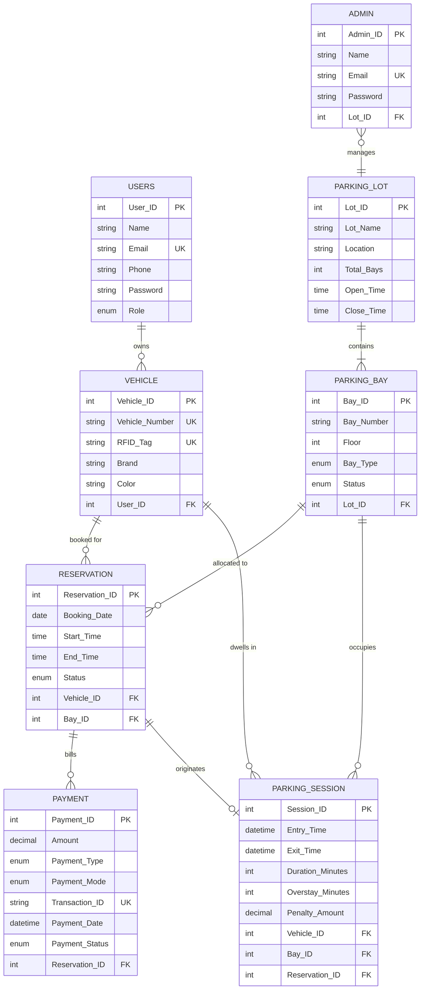

# ParkSmart - Smart Parking Management System

> **DBMS Project-Based Learning (PBL)**  
> A full-stack Smart Parking Management System featuring real-time bay availability, advance reservations, RFID gate entry/exit telemetry, automated overstay penalty calculation, and an administrative analytics portal.

---

## 📌 Table of Contents
1. [Overview](#-overview)
2. [System Architecture](#-system-architecture)
3. [Key Features](#-key-features)
4. [DBMS & Database Engineering Highlights](#-dbms--database-engineering-highlights)
5. [Prerequisites](#-prerequisites)
6. [Step-by-Step Installation & Setup](#-step-by-step-installation--setup)
   - [1. Database Setup](#1-database-setup)
   - [2. Backend Setup](#2-backend-setup)
   - [3. Frontend Setup](#3-frontend-setup)
7. [Running the Application](#-running-the-application)
8. [Automated Testing & Verification](#-automated-testing--verification)
9. [Demo Credentials](#-demo-credentials)
10. [REST API Endpoint Reference](#-rest-api-endpoint-reference)
11. [Switching Between Live Backend and Mock Mode](#-switching-between-live-backend-and-mock-mode)
12. [Database Schema & ER Relationships](#-database-schema--er-relationships)
13. [Directory Structure](#-directory-structure)
14. [Troubleshooting & Resetting Data](#-troubleshooting--resetting-data)

---

## 🚀 Overview

**ParkSmart** is an intelligent, end-to-end parking management platform designed to solve urban parking congestion. Built for a Database Management Systems (DBMS) project, it showcases rigorous database design principles—including relational constraints, stored procedures, triggers for conflict prevention, and analytical views—integrated with a responsive Node.js/Express REST backend and a modern frontend.

---

## 🏗 System Architecture

```text
┌────────────────────────────────────────────────────────────────┐
│                        CLIENT LAYER                            │
│  Vanilla HTML5 + Modern CSS + ES6 Modules + Chart.js + Lucide │
│          Driver Portal (Port 5500) | Admin Portal              │
└───────────────────────────────┬────────────────────────────────┘
                                │ HTTP / JSON (REST)
                                ▼
┌────────────────────────────────────────────────────────────────┐
│                        API LAYER (Node.js)                     │
│   Express 4 + Helmet + CORS + Rate Limiter + JWT + Bcrypt      │
│          Handcrafted Parameterized SQL (mysql2/promise)        │
└───────────────────────────────┬────────────────────────────────┘
                                │ Connection Pool (Port 3306)
                                ▼
┌────────────────────────────────────────────────────────────────┐
│                       DATABASE LAYER (MySQL 8)                 │
│  8 Tables (InnoDB) • 5 Views • 4 Stored Procedures • 3 Triggers │
│   ACID Transactions • FK Cascades • Custom SQLSTATE '45000'    │
└────────────────────────────────────────────────────────────────┘
```

---

## ✨ Key Features

### 🚗 Driver / User Features
- **Account & Fleet Management**: User registration with 10-digit mobile verification, bcrypt password hashing, and multiple vehicle registrations (License Plate, RFID Tag, Brand, Color).
- **Interactive Parking Discovery**: Visual facility cards displaying live bay counts, operating hours, and locations across multiple parking facilities.
- **Floor-wise Bay Grid**: Color-coded bay layout (**Green**: Available, **Amber**: Reserved, **Red**: Occupied) with bay-type indicators (Regular, EV with charging, Compact, Disabled).
- **Conflict-Free Reservations**: Time slot booking with automatic rate calculation (₹40/hr Regular, ₹60/hr EV, ₹30/hr Compact, ₹20/hr Disabled). Double-booking is blocked by database triggers.
- **Advance Fee Payment**: Simulated payment gateway supporting **UPI**, **Debit/Credit Card**, **Net Banking**, and **Cash** with unique `TXN` transaction generation.
- **Active Session Telemetry**: Real-time ticker and dwell timer for ongoing sessions inside the parking facility.
- **History & Overstay Alerts**: Transparent session history highlighting overstay minutes and penalty charges in red.

### 🛡️ Administrator Features
- **Analytics & Telemetry Dashboard**:
  - Live KPIs: Total Collected Revenue, Overall Occupancy Rate (%), Active Sessions, Pending Payments.
  - Interactive Visualizations: Facility occupancy comparison (Bar chart) and 14-day revenue trend (Line chart).
  - Recent Overstays monitor for rapid violation auditing.
- **Spatial Infrastructure Management (CRUD)**:
  - Add, edit, and delete Parking Lots with operating hours validation.
  - Add, filter, and delete Parking Bays with floor layout management and active reservation protection.
- **Gate Operations (Live Sessions)**:
  - Real-time gate monitoring of vehicles currently inside facilities.
  - **Mark Exit**: Executes checkout, calculates final duration, frees the bay to "Available", completes the reservation, and automatically computes an overstay penalty (₹2/minute) if the vehicle exceeded its booking window.
- **Central Audit Tables & Export**: Full search, filtering, and **Export to CSV** for Reservations, Payments, Vehicles, and Users.

---

## 🎓 DBMS & Database Engineering Highlights

This project emphasizes core database management concepts without using an ORM:

1. **Stored Procedures**:
   - `sp_create_reservation(vehicle, bay, date, start, end, OUT res_id)`: Atomically reserves a bay, calculates duration-based fees, and generates an invoice.
   - `sp_record_entry_by_rfid(rfid, OUT session_id)`: Gate barrier sensor simulation; matches RFID tag to active reservation, creates parking session, and marks bay as Occupied.
   - `sp_mark_exit(session_id, exit_time)`: Closes session, calculates duration, computes penalty (₹2/min overstay), creates penalty invoice, and frees the bay.
   - `sp_make_payment(payment_id, mode, OUT txn_id)`: Atomically updates payment record with unique transaction ID and marks status as Paid.

2. **Triggers**:
   - `trg_res_before_insert`: Validates operating hours, bay-facility alignment, and enforces non-overlapping time slots (`SIGNAL SQLSTATE '45000'`).
   - `trg_res_after_update`: Automatically frees the parking bay back to `Available` when a reservation is cancelled or completed.
   - `trg_payment_before_update`: Blocks duplicate payments on already settled transactions (`SIGNAL SQLSTATE '45000'`).

3. **Views**:
   - `v_lot_availability`: Computes real-time capacity, occupied counts, and occupancy percentages.
   - `v_reservation_details`: Joins User, Vehicle, Bay, Lot, and Payment records for reservations.
   - `v_session_history`: Formats duration, overstay, and penalty metrics for driver history.
   - `v_active_sessions`: Lists all vehicles currently inside parking lots with real-time dwell metrics.
   - `v_revenue_by_lot`: Aggregates settled revenue across parking facilities.

4. **15 Viva & Report Demonstration Queries**:
   - Located in [`database/queries.sql`](file:///home/ashrit/Desktop/CLG/DBMS/PBL/smartparking/database/queries.sql) demonstrating multi-table joins, subqueries, `GROUP BY ... HAVING`, and aggregate analytics.

---

## 💻 Prerequisites

Ensure you have the following installed on your system:
- **Node.js**: `v20.0.0` or higher ([Download Node.js](https://nodejs.org/))
- **MySQL Server**: `8.0` or higher ([Download MySQL](https://dev.mysql.com/downloads/mysql/))
- **Python 3** (or VS Code Live Server extension) for serving the static frontend

---

## 🛠 Step-by-Step Installation & Setup

### 1. Database Setup

1. Open your terminal or MySQL Workbench and log in as root:
   ```bash
   mysql -u root -p
   ```

2. Create the database and dedicated project user:
   ```sql
   CREATE DATABASE IF NOT EXISTS parksmart;
   CREATE USER IF NOT EXISTS 'parksmart_user'@'localhost' IDENTIFIED BY 'StrongPass@123';
   GRANT ALL PRIVILEGES ON parksmart.* TO 'parksmart_user'@'localhost';
   FLUSH PRIVILEGES;
   EXIT;
   ```

3. Import the schema and seed data:
   ```bash
   # From the project root:
   mysql -u parksmart_user -pStrongPass@123 parksmart < database/schema.sql
   mysql -u parksmart_user -pStrongPass@123 parksmart < database/sample_data.sql
   ```

---

### TERMINAL 1 (Backend)

```bash
cd backend
npm start
```

---

### TERMINAL 2 (Frontend)

```bash
python3 -m http.server 5500 --directory frontend
```

---

### 🌐 Access URLs

- Frontend: http://localhost:5500
- Login Page: http://localhost:5500/login.html
- Backend API: http://localhost:5000/api/health

### 🔑 Demo Credentials

- Driver: `user@parksmart.com` / `123456`
- Admin: `admin@parksmart.com` / `123456`


### 2. Backend Setup

1. Navigate to the `backend/` directory:
   ```bash
   cd backend
   ```

2. Install dependencies:
   ```bash
   npm install
   ```

3. Create the `.env` configuration file:
   ```bash
   cp .env.example .env
   ```

   Verify your `.env` contains:
   ```ini
   PORT=5000
   DB_HOST=localhost
   DB_PORT=3306
   DB_USER=parksmart_user
   DB_PASSWORD=StrongPass@123
   DB_NAME=parksmart
   JWT_SECRET=c8d488950d6fdb07d2c3df4057e937d94cf2fe6f54c9d7be1f098555e7178c77
   JWT_EXPIRES_IN=8h
   CORS_ORIGINS=http://localhost:3000,http://localhost:5500,http://127.0.0.1:5500
   ```

---

### 3. Frontend Setup

The frontend is built with vanilla HTML/CSS/JavaScript and does not require a build step (`npm install`). It only needs a static HTTP server.

Verify in [`frontend/js/config.js`](file:///home/ashrit/Desktop/CLG/DBMS/PBL/smartparking/frontend/js/config.js) that:
```javascript
export const CONFIG = {
  USE_MOCK: false,
  API_BASE_URL: 'http://localhost:5000/api',
  STORAGE_PREFIX: 'parksmart_'
};
```

---

## 🏃 Running the Application

### ⚡ Quick Start: One Command to Run Everything (Copy & Paste)

Copy and paste this single command block into your terminal from the **project root directory** to start MySQL, the Backend API (port 5000), and the Frontend Portal (port 5500) all at once:

```bash
systemctl start mysql && (cd backend && npm install && npm start &) && python3 -m http.server 5500 --directory frontend
```

*(If you are running from inside the `backend/` directory, run: `systemctl start mysql && npm install && (npm start &) && python3 -m http.server 5500 --directory ../frontend`)*

Once running, open your browser:
- **Landing Page**: [http://localhost:5500](http://localhost:5500)
- **Login Page**: [http://localhost:5500/login.html](http://localhost:5500/login.html)
- **API Health Check**: [http://localhost:5000/api/health](http://localhost:5000/api/health)

---

### Option A: Standard Two-Terminal Run (Recommended for Dev / Debugging)

1. **Terminal 1 - Backend Server**:
   ```bash
   cd backend
   npm run dev
   ```
   *The server starts at `http://localhost:5000/api` with live database connectivity and auto-reloading.*

2. **Terminal 2 - Frontend Client**:
   ```bash
   # From the project root:
   python3 -m http.server 5500 --directory frontend
   ```
   *(Or right-click `frontend/index.html` in VS Code and select "Open with Live Server" on port 5500).*

3. **Open in Browser**:
   - Landing Page: **`http://localhost:5500`**
   - Direct Login: **`http://localhost:5500/login.html`**

---

## 🧪 Automated Testing & Verification

Run the end-to-end integration test suite to verify all stored procedures, triggers, security policies, and endpoints:

```bash
cd backend
npm test
```

### Smoke Test Coverage (21 Automated Checks):
- User & Administrator authentication branching
- Rejection of invalid credentials (HTTP 401)
- User registration and auto-login workflow
- Vehicle fleet addition and unique license/RFID constraints (HTTP 409)
- Parking facility availability metrics & bay layout retrieval
- Conflict-free reservation booking via `sp_create_reservation`
- Overlap trigger rejection (`SQLSTATE '45000'` &rarr; HTTP 400)
- Advance fee payment via `sp_make_payment` and double-payment prevention
- Role-based route guard enforcement (Driver denied `/admin/stats` with HTTP 403)
- Gate exit checkout via `sp_mark_exit` and automatic penalty invoice generation
- Reservation cancellation and automatic bay release trigger
- Driver profile modification & password updates

---

## 🔑 Demo Credentials

| Role | Email | Password | Pre-seeded Features |
|---|---|---|---|
| **Driver (User)** | `user@parksmart.com` | `123456` | 2 Registered vehicles (`MP07 AB 1234`, `MP07 CD 5678`), 1 live active session (#7 in Bay F2-01), 1 upcoming reservation, past history. |
| **Administrator** | `admin@parksmart.com` | `123456` | Access to City Center Mall facility (#1), admin dashboard, gate operations, lot/bay CRUD, and financial reports. |

*(Quick-fill demo chips are also available on the login page for one-click access).*

---

## 📡 REST API Endpoint Reference

All endpoints return uniform JSON responses:
```json
{
  "success": true,
  "data": { ... },
  "message": "Human readable status"
}
```

### 1. Authentication (`/api/auth`)
| Method | Endpoint | Access | Description |
|---|---|---|---|
| `POST` | `/auth/register` | Public | Register new driver account (10-digit phone, min 6 char password). Returns JWT. |
| `POST` | `/auth/login` | Public | Authenticate user or admin. Returns JWT token and profile object. |

### 2. Vehicle Fleet (`/api/vehicles`)
| Method | Endpoint | Access | Description |
|---|---|---|---|
| `GET` | `/vehicles` | User / Admin | List vehicles (Driver sees own; Admin sees all with owner details). |
| `POST` | `/vehicles` | User / Admin | Register a vehicle (license plate, RFID tag, brand, color). |
| `PUT` | `/vehicles/:id` | Owner / Admin | Update vehicle details. |
| `DELETE` | `/vehicles/:id` | Owner / Admin | Remove vehicle (blocked if vehicle has Upcoming/Active bookings). |

### 3. Facilities & Bays (`/api/lots`)
| Method | Endpoint | Access | Description |
|---|---|---|---|
| `GET` | `/lots` | Public | Get parking facilities with live availability counts (`v_lot_availability`). |
| `GET` | `/lots/:id/bays` | Public | Get bays for a facility with optional `?floor=` query parameter. |

### 4. Reservations (`/api/reservations`)
| Method | Endpoint | Access | Description |
|---|---|---|---|
| `GET` | `/reservations` | User / Admin | List reservations with optional `?status=` filter (`v_reservation_details`). |
| `POST` | `/reservations` | User / Admin | Create reservation via `sp_create_reservation`. Returns reservation & fee. |
| `PATCH` | `/reservations/:id/cancel` | Owner / Admin | Cancel upcoming reservation. Database trigger frees bay back to `Available`. |

### 5. Gate Sessions (`/api/sessions`)
| Method | Endpoint | Access | Description |
|---|---|---|---|
| `GET` | `/sessions` | User / Admin | Session history (supports `?active=true`, `?from=`, `?to=`). |
| `POST` | `/sessions/entry` | Admin | RFID barrier entry simulation via `sp_record_entry_by_rfid`. |
| `PATCH` | `/sessions/:id/exit` | Admin | Barrier exit checkout via `sp_mark_exit`. Computes overstay penalty. |

### 6. Payments & Invoices (`/api/payments`)
| Method | Endpoint | Access | Description |
|---|---|---|---|
| `GET` | `/payments` | User / Admin | Retrieve invoices/payments with optional `?status=` filter. |
| `POST` | `/payments/:id/pay` | Owner / Admin | Settle payment via `sp_make_payment` (UPI, Card, Net Banking, Cash). |

### 7. Profile (`/api/profile` & `/api/users`)
| Method | Endpoint | Access | Description |
|---|---|---|---|
| `GET` | `/profile` | User / Admin | Retrieve current authenticated user profile. |
| `PUT` | `/profile` | User / Admin | Update name and contact phone number. |
| `PUT` | `/profile/password` | User / Admin | Update password (validates current password against bcrypt hash). |

### 8. Admin Portal (`/api/admin`)
| Method | Endpoint | Access | Description |
|---|---|---|---|
| `GET` | `/admin/stats` | Admin | Real-time KPIs, lot occupancy distribution, 14-day revenue chart, overstays. |
| `POST` | `/admin/lots` | Admin | Create new parking lot facility. |
| `PUT` / `DELETE` | `/admin/lots/:id` | Admin | Update or delete parking lot facility. |
| `POST` | `/admin/bays` | Admin | Add new parking bay to facility/floor. |
| `DELETE` | `/admin/bays/:id` | Admin | Delete parking bay (blocked if bay has active bookings). |
| `GET` | `/admin/users` | Admin | List all registered users. |
| `DELETE` | `/admin/users/:id` | Admin | Delete user account (cascades to vehicles). |

---

## 🔄 Switching Between Live Backend and Mock Mode

The frontend includes an offline mock database layer. You can toggle between live backend API calls and self-contained browser mock data in [`frontend/js/config.js`](file:///home/ashrit/Desktop/CLG/DBMS/PBL/smartparking/frontend/js/config.js):

- **Live Backend Mode (Default)**:
  ```javascript
  export const CONFIG = {
    USE_MOCK: false,
    API_BASE_URL: 'http://localhost:5000/api'
  };
  ```
- **Offline Mock Mode (No backend required)**:
  ```javascript
  export const CONFIG = {
    USE_MOCK: true
  };
  ```

---

## 🗄 Database Schema & ER Relationships



---

## 📂 Directory Structure

```text
smartparking/
├── backend/
│   ├── config/
│   │   └── db.js                 # mysql2/promise connection pool & health check
│   ├── middleware/
│   │   ├── auth.js               # JWT verification & role authorization guards
│   │   ├── errorHandler.js       # Central error mapper (SQLSTATE 45000, 1062, 1451)
│   │   └── validate.js           # express-validator first-error formatter
│   ├── routes/
│   │   ├── admin.routes.js       # Admin KPIs, charts, lots/bays CRUD, user audits
│   │   ├── auth.routes.js        # User & Admin login, driver registration
│   │   ├── lots.routes.js        # Public lot availability & bay layouts
│   │   ├── payments.routes.js    # Invoice management & sp_make_payment settlement
│   │   ├── profile.routes.js     # Driver contact & password updates
│   │   ├── reservations.routes.js# Booking creation & cancellation
│   │   ├── sessions.routes.js    # Session history, live sessions, barrier entry/exit
│   │   └── vehicles.routes.js    # Fleet CRUD with ownership validation
│   ├── test/
│   │   ├── checklist-verifier.js # Comprehensive security, XSS & rate limit test
│   │   └── smoke-test.js         # 21-step automated integration test suite
│   ├── utils/
│   │   ├── asyncHandler.js       # Async error forwarding wrapper
│   │   └── response.js           # Standard { success, data, message } envelope
│   ├── .env                      # Environment secrets (git-ignored)
│   ├── .env.example              # Environment template
│   ├── package.json              # Node.js dependencies & test scripts
│   └── server.js                 # Express application bootstrapper & middleware
│
├── database/
│   ├── schema.sql                # DDL: 8 tables, 5 views, 4 stored procedures, 3 triggers
│   ├── sample_data.sql           # Realistic seed data with bcrypt passwords
│   └── queries.sql               # 15 demonstration viva queries & procedural tests
│
├── frontend/
│   ├── admin/                    # Admin portal pages (dashboard, bays, lots, sessions, etc.)
│   ├── user/                     # Driver portal pages (dashboard, find parking, vehicles, etc.)
│   ├── css/                      # Design system (variables, components, responsive layout)
│   ├── js/
│   │   ├── pages/                # Page-specific frontend controllers
│   │   ├── api.js                # Unified data access layer (HTTP fetch & mock toggle)
│   │   ├── auth.js               # Client session state & route guards
│   │   ├── config.js             # API base URL & mock mode toggle configuration
│   │   ├── mock-data.js          # In-browser fallback mock database
│   │   └── ui.js                 # Toast notifications, modals, table helpers, formatting
│   ├── index.html                # Responsive landing page
│   ├── login.html                # User / Admin unified login interface
│   └── register.html             # Driver registration form
│
└── tasks.md                      # Comprehensive 18-section verification checklist
```

---

## 🔧 Troubleshooting & Resetting Data

### Resetting the Database to Initial State
If test bookings, vehicle additions, or session exits have altered the demonstration data, reset the database to clean seed values with one command:

```bash
mysql -u parksmart_user -pStrongPass@123 parksmart -e "
SET FOREIGN_KEY_CHECKS=0;
TRUNCATE TABLE payment;
TRUNCATE TABLE parking_session;
TRUNCATE TABLE reservation;
TRUNCATE TABLE vehicle;
TRUNCATE TABLE admin;
TRUNCATE TABLE parking_bay;
TRUNCATE TABLE parking_lot;
TRUNCATE TABLE users;
SET FOREIGN_KEY_CHECKS=1;" && mysql -u parksmart_user -pStrongPass@123 parksmart < database/sample_data.sql
```

### Port Conflicts
- If **port 5000** is in use, modify `PORT=5000` in `backend/.env` and adjust `API_BASE_URL` in `frontend/js/config.js`.
- If **port 5500** is in use, start the frontend server on any other port (e.g., `python3 -m http.server 3000 --directory frontend`) and ensure the origin is listed in `CORS_ORIGINS` in `backend/.env`.
